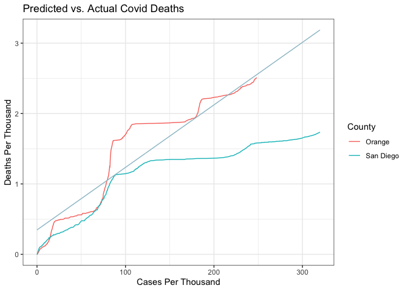

SoCal Covid Outcomes
================

## Introduction

The five most populous counties in California (Los Angeles, Orange,
Riverside, San Bernardino, and San Diego) are all located in Southern
California. Despite being geographically contiguous, the counties are
dissimilar in a number of ways, from population size to median income
and educational attainment. Given the known effects of certain demographic details like age and
income on COVID incidence and mortality, I wanted to investigate whether
these counties had notably different outcomes regarding case numbers and
mortality rates during the pandemic.

| County | Population (in millions) | Median Age | Median Household Income | Percentage of Pop. with a Bachelor’s Degree or Higher |
|----|----|----|----|----|
| **Los Angeles** | 10.0 | 38.9 | \$90,845 | 37.2% |
| **Orange** | 3.2 | 40.2 | \$115,229 | 44.7% |
| **Riverside** | 2.4 | 37.6 | \$93,172 | 26.2% |
| **San Bernardino** | 2.2 | 35.3 | \$88,294 | 24.1% |
| **San Diego** | 3.3 | 37.8 | \$109,132 | 45.2% |

<small>Data Source: U.S. Census Bureau</small>

## Data

The data used for this project comes from the COVID-19 data repository
by the Center for Systems Science and Engineering at Johns Hopkins
University. In particular, I used the time series summaries for
confirmed cases and deaths in the United States, which includes data
from the beginning of the pandemic, in January of 2020, to the point at
which Johns Hopkins stopped aggregating data, in March of 2023. All of
the case and death totals originally came from each county’s department
of public health.

## Visualizations

<!-- -->

The first thing I wanted to explore with visualizations was the
cumulative case counts for the five counties over the time period for
which we have data. All of the counties saw spikes in case counts around
the beginning of the year in 2021 and 2022. From 2021 to 2022, San
Bernardino, Los Angeles, and Riverside counties had greater case counts
than did San Diego and Orange counties. By the beginning of 2022,
however, Orange county had notably lower cumulative cases than the other
four counties did.

<!-- -->

When it came to COVID deaths, the cumulative totals diverged more
starkly In particular, San Diego County, despite having the third
highest cumulative case rate, had the lowest number of deaths for almost
the entire period for which we have data. Conversely, Orange County had
the fourth highest number of deaths, beginning in 2021, despite having
the lowest number of cumulative cases over nearly the same time period.

## Modeling

San Diego and Orange counties are similar in many ways: they have
similar median incomes, educational attainments, and population totals.
Thus, I was interested in further exploring the disparity between their
pandemic outcomes and seeing if I could see more specifically where
their fortunes may have diverged. I used a linear model to predict
deaths per thousand, using the cases per thousand information from all
of the five counties. Then, I graphed the cases per thousand relative to
the deaths per thousand for both counties and added the linear model to
the graph for comparison.

<!-- -->

## Conclusions

San Diego and Orange counties had somewhat similar mortality rates,
relative to their case count, until their respective cumulative cases
reached approximately 70 cases per thousand, a benchmark which they both
reached in January of 2021. At that point, their trajectories diverged.
In the end, Orange County’s mortality rate ended up being similar to
that predicted by the linear model, while San Diego’s remained
significantly lower.

There are many potential factors that could have caused this disparity
to happen. Orange County’s population is notably older than San Diego
County’s is, with a median age of 40.2 vs. 37.8, and age has been shown
to affect COVID mortality rates.

Additionally, vaccines became widely available in 2021, and vaccine
rates may have differed between the two counties. San Diego County is
home to multiple military facilities, and members of the military not
only qualified for vaccines earlier than the general public did but also
were required to get fully vaccinated for COVID (until January of 2023).

Finally, the political makeup of San Diego and Orange counties differs.
According to the California Secretary of State’s website, 41.58% and
26.82% of San Diego County residents are registered as Democrats and
Republicans, respectively, while those values are 37.61% and 33.07% for
Orange County. Since vaccine adoption in the United States has been
shown to be correlated with membership in a political party (with
Democrats more likely to get vaccinated than Republicans), this
disparity in political affiliation could very well have affected vaccine
uptake in both counties as well.

Without taking into account more information about San Diego and Orange
counties, it is ultimately impossible to say for sure what led to such
disparate outcomes for the two areas. However, all of the factors
mentioned above would provide interesting avenues for future inquiry.

## Caveats and Potential Sources of Bias

COVID data was notoriously difficult to source. Many people with COVID
either did not get tested for it (early in the pandemic) or used home
tests, the results of which they did not report (later in the pandemic).
Thus, the case counts likely represent a vast under count of the actual
cases of COVID circulating at any time. Additionally, the COVID death
metric could be more complicated than it appears. Many people that died
with COVID had other comorbidities that contributed to their deaths.
It’s possible that the death count also is an under count, as COVID
might not have been listed as the cause of death on some death
certificates, even if it was a factor.

Finally, to acknowledge personal bias: I am a resident of Los Angeles
County and resided in that county for the entirety of the time studied
here. As such, I saw certain events on the news, like anti-lockdown
protests in Huntington Beach (a town in Orange County), which may have
affected my views of the five counties studied. However, I made an
attempt to be led by the data at all times and to not let my personal
biases affect my work.
